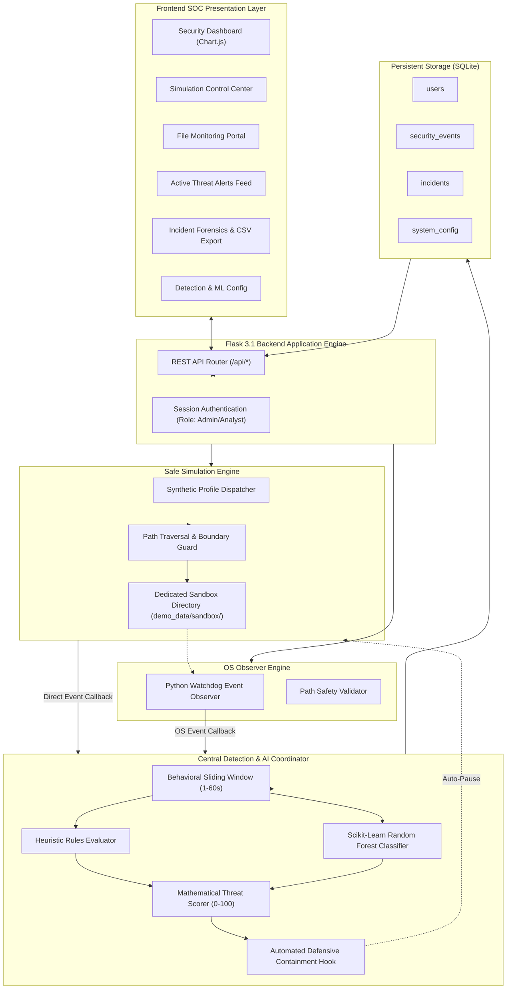
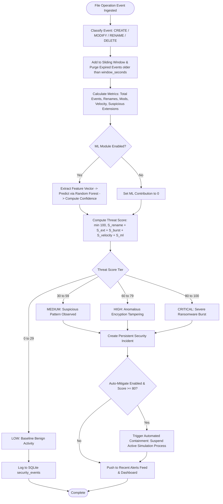
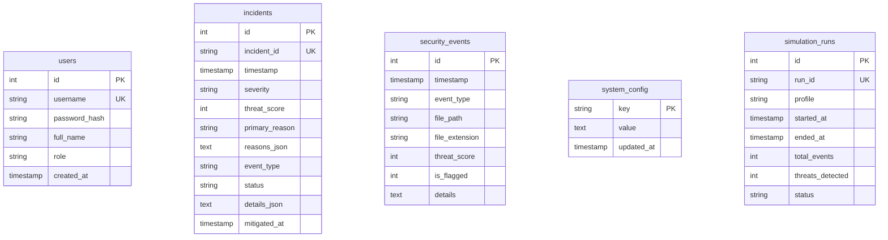

# Major Project Documentation: Behavioral Ransomware Detection Simulator

**Project Title:** Safe Real-Time Behavioral Ransomware Detection & Telemetry Simulator  
**Degree:** Bachelor of Technology in Computer Science & Engineering (Artificial Intelligence & Machine Learning)  
**Academic Year:** 2025–2026  

---

## 1. Problem Statement

Ransomware represents one of the most critical threats in modern cyberspace, causing billions of dollars in global disruption across healthcare, banking, and critical infrastructure. 

Traditional signature-based antivirus solutions (legacy AV) operate by matching known binary hashes (MD5, SHA-256) against a database of previously cataloged malware. Cyber adversaries routinely bypass signature detection using polymorphic packers, crypters, and zero-day compiler alterations. 

To defend against zero-day ransomware, defensive cybersecurity has transitioned toward **Behavioral Anomaly Detection (Next-Generation Antivirus / Endpoint Detection & Response - EDR)**. However, demonstrating and researching ransomware behavior in academic environments is fraught with severe risks of accidental infection or data loss.

There is a critical academic and engineering need for a **safe, contained, defensive simulation and behavioral detection platform** that mimics ransomware activity (rapid extension modifications, burst modifications, abnormal I/O velocities) on harmless dummy files, computes an explainable multi-factor threat score, and generates real-time forensic alerts without endangering host systems.

---

## 2. Project Objectives

1. **Safety-First Design**: Implement a sandbox-confined simulation engine that strictly operates on harmless dummy files and prevents any access or modification to host operating system files.
2. **Behavioral Telemetry Ingestion**: Develop real-time OS-level file monitoring using Python `watchdog` to capture creation, modification, deletion, and renaming operations without reading private file contents.
3. **Sliding-Window Behavioral Analysis**: Construct an in-memory sliding time window that tracks operation velocities, rename bursts, and unusual extension tampering.
4. **Transparent Mathematical Threat Scoring**: Formulate an explainable scoring algorithm (0 to 100) with attribution breakdown into specific heuristic contributions and severity tiers.
5. **AI/ML Behavioral Verification**: Integrate a Scikit-Learn supervised Random Forest classifier trained on synthetic behavioral feature vectors to demonstrate AI's role in anomaly triage.
6. **Defensive Response Automation**: Demonstrate automated containment (simulated process suspension) when critical threat thresholds are breached.
7. **SOC Incident Management & Compliance**: Persist forensic incidents in SQLite with full filtering, forensic modal inspection, and CSV export.

---

## 3. Existing System vs. Proposed System

| Parameter | Existing System (Signature-Based AV) | Proposed System (Behavioral Simulator) |
| :--- | :--- | :--- |
| **Detection Mechanism** | Static file checksums (MD5/SHA256) | In-flight behavioral heuristics + Velocity tracking |
| **Zero-Day Resilience** | Ineffective until signature is created and pushed | Effective against unknown binaries by tracking actions |
| **Telemetry Depth** | Binary inspection | Operation velocity, rename bursts, extension alterations |
| **Explainability** | Opaque signature code (e.g., `Win32.Trojan.X`) | Mathematical formula string + Feature attribution |
| **Demonstration Safety**| Dangerous (requires running live malware in isolated VMs)| 100% Safe (harmless dummy files in strict sandbox) |
| **Resource Overhead** | Heavy disk reads | Zero content inspection; metadata-only processing |

---

## 4. System Architecture

### 4.1 Mermaid Architecture Diagram



---

## 5. Detection Algorithm & Workflow

### 5.1 Detection Flowchart



---

## 6. Threat Scoring Formula

The threat score ($S_{\text{total}}$) is calculated in the range $[0, 100]$:

$$S_{\text{total}} = \min\left(100, S_{\text{rename}} + S_{\text{ext}} + S_{\text{burst}} + S_{\text{velocity}} + S_{\text{ml}}\right)$$

### Factor Contributions:
1. **File Rename Frequency ($S_{\text{rename}}$)**:
   $$S_{\text{rename}} = \min\left(W_{\text{rename}}, \frac{N_{\text{renames}}}{T_{\text{rename}}} \times W_{\text{rename}}\right)$$
   *(Default $W_{\text{rename}} = 35$, $T_{\text{rename}} = 4$)*

2. **Suspicious Extension Tampering ($S_{\text{ext}}$)**:
   $$S_{\text{ext}} = \begin{cases} 
   0.0 & \text{if } N_{\text{suspicious\_ext}} = 0 \\
   0.7 \times W_{\text{ext}} & \text{if } N_{\text{suspicious\_ext}} = 1 \\
   W_{\text{ext}} & \text{if } N_{\text{suspicious\_ext}} \ge 2 
   \end{cases}$$
   *(Default $W_{\text{ext}} = 40$. Detects extensions: `.locked`, `.crypto`, `.crypted`, `.enc`, `.ransom`, `.wnry`)*

3. **Burst Modification Rate ($S_{\text{burst}}$)**:
   $$S_{\text{burst}} = \min\left(W_{\text{burst}}, \frac{N_{\text{mods}}}{T_{\text{mod}}} \times W_{\text{burst}}\right)$$
   *(Default $W_{\text{burst}} = 25$, $T_{\text{mod}} = 6$)*

4. **Event Velocity ($S_{\text{velocity}}$)**:
   $$S_{\text{velocity}} = \min\left(10.0, \frac{V_{\text{events}}}{T_{\text{velocity}}} \times 10.0\right) \quad \text{if } \frac{V_{\text{events}}}{T_{\text{velocity}}} > 0.8 \text{ else } 0.0$$

5. **Machine Learning Confidence Boost ($S_{\text{ml}}$)**:
   If the Random Forest classifier predicts `Ransomware-like Anomaly` with $P \ge 0.75$, a contextual boost ($+15$ pts) is added if borderline indicators exist.

---

## 7. Machine Learning Module Design

- **Architecture:** Random Forest Classifier ($N_{\text{estimators}} = 40, \text{Max Depth} = 6$) with balanced class weights.
- **Features Extracted:**
  1. `events_per_sec`: Event velocity within the sliding window.
  2. `rename_rate`: File renames per second.
  3. `ext_change_ratio`: Fraction of operations involving suspicious extensions.
  4. `mod_burst_rate`: File write and modification operations per second.
  5. `unique_ext_count`: Number of distinct file extensions observed.
- **Explainability:** Feature importance scores are calculated using Gini impurity reduction and exposed in the UI.

---

## 8. Database Design



---

## 9. Verification & Automated Test Results

The test suite was executed using Pytest:
- **Total Test Cases:** 15
- **Passed:** 15 (100%)
- **Failed:** 0
- **Duration:** 23.20 seconds

```
tests/test_api.py::test_login_flow PASSED
tests/test_api.py::test_protected_routes_require_login PASSED
tests/test_api.py::test_authenticated_dashboard_stats PASSED
tests/test_api.py::test_settings_persistence PASSED
tests/test_api.py::test_csv_export_endpoint PASSED
tests/test_detection.py::test_benign_events_produce_low_threat_score PASSED
tests/test_detection.py::test_ransomware_burst_triggers_critical_alert PASSED
tests/test_detection.py::test_sliding_window_purges_expired_events PASSED
tests/test_detection.py::test_ml_classifier_predicts_behavior PASSED
tests/test_monitoring.py::test_validate_monitoring_path_accepts_sandbox PASSED
tests/test_monitoring.py::test_validate_monitoring_path_rejects_unsafe_paths PASSED
tests/test_monitoring.py::test_file_monitor_start_and_stop PASSED
tests/test_simulation.py::test_sandbox_path_validation PASSED
tests/test_simulation.py::test_simulation_lifecycle_controls PASSED
tests/test_simulation.py::test_multiple_simulations_prevented PASSED
```

---

## 10. Viva Q&A Guide for Faculty Review

**Q1: Why use behavioral detection instead of hash-based signatures?**  
*Answer:* Attackers frequently re-compile or repack ransomware binaries, resulting in completely different cryptographic hashes for each variant. Behavioral detection monitors what the process actually *does* (e.g., modifying 10 files per second and changing extensions to `.locked`), allowing the system to flag zero-day ransomware without waiting for a signature release.

**Q2: How does the application guarantee host system safety?**  
*Answer:* The simulator uses strict path boundary assertion (`is_safe_sandbox_path`). All synthetic operations (creation, modification, simulated cipher writing) are strictly confined to `demo_data/sandbox/`. Unsafe system paths (`C:\`, `C:\Windows`, user profile roots) and path traversal sequences (`../`) are systematically rejected.

**Q3: How does the sliding window operate?**  
*Answer:* The engine maintains a deque of timestamped file events. When evaluating metrics, any event with a timestamp older than `current_time - window_seconds` is purged. This ensures that calculations reflect instantaneous velocity rather than cumulative history.

**Q4: What is the role of Machine Learning in this project?**  
*Answer:* The Scikit-Learn Random Forest model demonstrates how AI can augment rule-based heuristics. By evaluating multi-dimensional vectors (velocity, rename rate, extension change ratio), the classifier assigns a probabilistic confidence score and surfaces the most influential features.

**Q5: What is the 3-2-1 backup strategy?**  
*Answer:* 3 copies of critical data, across 2 different media types, with at least 1 copy stored offsite or in an immutable/air-gapped format. Even if ransomware executes successfully, immutable backups allow total data restoration without paying a ransom.

---

## 11. Conclusion & Future Scope

The **Ransomware Detection Simulator** achieves a complete defensive cybersecurity platform that combines safe simulation, real-time operating system file observation, sliding-window behavioral analysis, explainable threat scoring, and machine learning triage.

### Future Scope:
- Integration with Windows API file system mini-filter drivers for kernel-level I/O interception.
- Kernel-level automated process killing (`taskkill /F /PID`) upon critical threat detection.
- Shannon entropy file calculation to detect raw high-entropy block writes before renaming.
- Integration with MITRE ATT&CK framework mapping for enterprise EDR compliance.
